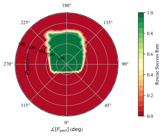

# exoRL

Reinforcement-learning balance control for the Symbitron WE2, an 8-DOF lower-limb exoskeleton with series elastic actuators, built as an [Isaac Lab](https://github.com/isaac-sim/IsaacLab) external project.

Code accompanying the MSc thesis *"Sim-to-Real Transfer of Reinforcement Learning Policies for Lower-Limb Exoskeleton Control"* (University of Twente, 2026).

<p align="center">
  
  <br><em>Share of 150 ms pushes survived by the torque policy, by push direction and magnitude (10,000 simulated robots per direction).</em>
</p>

## What is in here

- **Direct-RL task** `Template-Exorl-Direct-v0` (`source/exoRL/exoRL/tasks/direct/exorl/`): standing balance with two action modes (joint position targets through a PD layer, or direct joint torques).
- **Reward design** with control-barrier-function terms that keep the policy away from joint and torque limits.
- **Sim-to-real measures**: discretized series-elastic-actuator models inside the simulation loop, domain randomization (masses, friction, gravity), sensor noise measured on the real device, randomized initial poses.
- **Curriculum training** in stages (no augmentation, sensor noise, configuration randomization) via `scripts/experiments/incremental_training.sh`.
- **Disturbance tests**: 150 ms pushes from 36 directions on 10,000 parallel environments.

PPO is trained with [rsl_rl](https://github.com/leggedrobotics/rsl_rl); the rl_games and skrl entry points from the Isaac Lab template are kept.

> **Note:** the exoskeleton robot model (URDF/USD, meshes), the hardware control files and the raw actuator parameter file are proprietary and not included. The environment therefore cannot be run out of the box: `source/exoRL/exoRL/tasks/direct/exorl/exoWE2_V2.py` expects a robot USD file.

## Installation

Install Isaac Lab by following its [installation guide](https://isaac-sim.github.io/IsaacLab/main/source/setup/installation/index.html), then install this extension in editable mode from the repository root:

```bash
python -m pip install -e source/exoRL
```

Check that the task is registered:

```bash
python scripts/list_envs.py
```

## Usage

Train a policy (with the Isaac Lab Docker container, prefix the commands with `/workspace/isaaclab/isaaclab.sh -p`):

```bash
python scripts/rsl_rl/train.py --task=Template-Exorl-Direct-v0 --headless
```

Train with the staged curriculum:

```bash
bash scripts/experiments/incremental_training.sh
```

Play a trained policy, or run a disturbance test in one push direction:

```bash
python scripts/rsl_rl/play.py --task=Template-Exorl-Direct-v0 --checkpoint=<path/to/model.pt>
python scripts/rsl_rl/play.py --task=Template-Exorl-Direct-v0 --num_envs=10000 \
    --checkpoint=<path/to/model.pt> --disturbance_tests --direction 0.0
```

`scripts/experiments/dist_tests.sh` sweeps all directions from 0 to 350 degrees (set the checkpoint path in the script and run it from `scripts/experiments/`). Training and test logs are written to `logs/`.

## Repository structure

```
exoRL/
├── scripts/
│   ├── rsl_rl/              # train.py, play.py (incl. disturbance tests)
│   ├── rl_games/, skrl/     # template entry points for other RL libraries
│   ├── experiments/         # curriculum training, disturbance sweep, env-count benchmark
│   └── list_envs.py, zero_agent.py, random_agent.py
├── source/exoRL/            # Isaac Lab extension (task, env config, agent configs)
└── misc/                    # thesis material outside the Isaac Lab project
```

`misc/` holds everything that supports the thesis but is not part of the Isaac Lab project:

| Folder | Contents |
|--------|----------|
| `ActuatorDynamics/` | MATLAB identification and simulation of the series elastic actuators (after Rampeltshammer et al., 2020) |
| `convertingNN/` | Converters from ONNX/PyTorch policies to MATLAB for deployment in TwinCAT 3 |
| `evaluation/` | Analysis of training sub-rewards, control barrier functions and disturbance tests, incl. result plots |
| `Data/` | Hardware test recordings, measured sensor noise amplitudes and IMU drift |
| `humanMotion/` | Processing of human reference motion |
| `copilot_agents/` | Prompt files for code-analysis assistants used while writing the thesis |
| `commands.md` | Personal notes on container and training commands |

Some evaluation scripts contain absolute paths from the original workstation and need adjusting before use.

## Human reference motion

Human reference motion (subject AB08, level-ground walking) is taken from the open gait dataset by Camargo et al. (2021), *"A comprehensive, open-source dataset of lower limb biomechanics in multiple conditions of stairs, ramps, and level-ground ambulation and transitions"*, Journal of Biomechanics, 119, 110320. https://doi.org/10.1016/j.jbiomech.2021.110320

The raw data is not redistributed here; to run the scripts in `misc/humanMotion/`, download the dataset and place the subject's `ik/` files under `misc/humanMotion/AB08/ik/`.

## License

All rights reserved. This code is published for viewing only; see [LICENSE](LICENSE).
